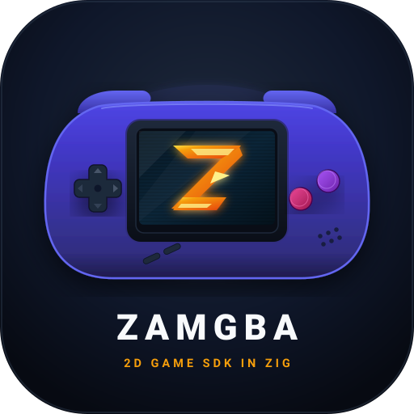

<p align="center">
  
</p>

<h1 align="center">Zamgba</h1>

<p align="center">
  <strong>A type-safe Game Boy Advance (GBA) SDK and 2D Game Engine in pure Zig.</strong>
</p>

<p align="center">
  <a href="https://ziglang.org/"></a>
  <a href="build.zig.zon"></a>
  <a href="https://en.wikipedia.org/wiki/Game_Boy_Advance"></a>
</p>

---

> [!IMPORTANT]
> **Disclaimer:** Zamgba is an unofficial homebrew development tool. It is not affiliated with, authorized, sponsored, or endorsed by Nintendo Co., Ltd. "Game Boy", "GBA", and "Game Boy Advance" are registered trademarks of Nintendo.

---

## Overview

**Zamgba** is an open-source Software Development Kit (SDK) and 2D game engine for the Game Boy Advance (GBA), written entirely in **Zig**.

Zamgba bridges the gap between low-level bare-metal hardware programming and modern game development workflows. It provides a clean, two-layer architecture:
- **`zamgba.hal`**: A type-safe hardware abstraction layer mapping GBA registers, VRAM, OAM, and display modes without raw pointer arithmetic.
- **`zamgba.engine`**: A high-level 2D engine featuring camera viewport tracking, parallax scrolling, sub-pixel tilemap physics, and automated VRAM streaming.

---

## Why Zig?

GBA homebrew has traditionally relied on C/C++ toolchains like devkitARM. Zamgba chooses [Zig](https://ziglang.org) as its foundation for several compelling reasons:

1. **Modern Cross-Compilation Toolchain**: Zig provides a self-contained, zero-dependency compiler that cross-compiles out of the box to `thumb-freestanding-eabi` (`arm7tdmi`), eliminating complex external toolchain setups.
2. **Type-Safe Hardware Registers**: Zig's `packed struct` and distinct integer types (`u1`, `u2`, `u5`, etc.) match GBA memory-mapped I/O (MMIO) registers bit-for-bit, providing compile-time type safety without cumbersome C bitmask macros.
3. **Zero-Cost Compile-Time Metaprogramming (`comptime`)**: Layout validation, ROM header generation, asset embedding, and math lookup tables are computed at compile time with zero runtime overhead.
4. **Predictable Bare-Metal Control**: Zig does not have hidden control flow, runtime memory allocations, or a garbage collector. Every instruction and memory layout remains strictly under developer control, which is essential for constrained hardware with 384 KB of RAM.

---

## Standout Feature: Seamless Modern Tooling Integration (`zurag`)

The biggest highlight of Zamgba is its integration with modern, industry-standard content creation tools via its built-in companion CLI tool **`zurag`**:

### 1. Aseprite Animation Pipeline
Instead of manually slicing spritesheets or writing hardcoded frame offsets, `zurag` directly ingests **[Aseprite](https://www.aseprite.org)** JSON metadata and sprite sheets:
- Automatically packs 8×8 GBA tiles and slices frame tags.
- Supports both static ROM-to-VRAM preloading and real-time VRAM tile streaming via VBlank DMA.
- **Explore Demos**:
  - [`demo/engine/flappy_tsetseg.zig`](demo/engine/flappy_tsetseg.zig) (Static all-frame VRAM preloading)
  - [`demo/engine/flappy_tsetseg_streaming.zig`](demo/engine/flappy_tsetseg_streaming.zig) (DMA-driven single-slot VRAM streaming)

### 2. LDtk Level Editor & TileMap Pipeline
Level design is performed in **[LDtk](https://ldtk.io)** (2D Level Designer) rather than legacy grid editors:
- Automatically parses LDtk `.ldtk` project files, extracts tile layers, deduplicates identical 8×8 tiles, and generates packed 16-bit `ScreenEntry` maps.
- Ingests LDtk `IntGrid` collision layers and integrates them directly into the engine's 2D physics system.
- **Explore Demos**:
  - [`demo/engine/ldtk_minimal.zig`](demo/engine/ldtk_minimal.zig) (Minimal standalone LDtk Mode 0 tilemap rendering)
  - [`demo/engine/camera_demo.zig`](demo/engine/camera_demo.zig) (Large scrolling LDtk world with smooth camera tracking)
  - [`demo/engine/tilemap_collision.zig`](demo/engine/tilemap_collision.zig) (Continuous sub-pixel box-to-tilemap physics and collision response)

---

## Key Highlights

- **Type-Safe Hardware Abstraction (`zamgba.hal`)**: Directly maps GBA physical registers (MMIO), VRAM, PALRAM, and OAM into packed Zig structs, eliminating unsafe pointer arithmetic and brittle C macros. Supports Graphics Modes 0 through 5 and hardware VBlank synchronization.
- **High-Level 2D Engine (`zamgba.engine`)**: Provides high-level game loop orchestration (`engine.run`), `StaticSprite` and `AnimatedSprite` entities, sub-pixel physics (`Fixed24_8`), and AABB collision detection.
- **Dynamic VRAM Streaming & DMA**: Features a dynamic VRAM tile allocator (`VramAllocator`) and VBlank DMA queue (`DmaQueue`) to stream multi-frame sprite animations seamlessly from ROM into VRAM without CPU copy stalls.
- **2D Camera & Parallax Scrolling**: Robust `Camera2D` supporting target tracking, lerp smoothing, deadzone margins, bounds clamping, screen shake, frustum culling, and multi-layer parallax scrolling.
- **Mode 0 TileMap Engine**: ScreenBlock management, packed 16-bit `ScreenEntry`, and continuous collision resolution against background tile layers (`moveAndCollide`).
- **Asset Pipeline Tool (`zurag`)**: Offline CLI tool compiling PNG sprites, Aseprite animations, and LDtk tilemap levels into zero-overhead Zig data structures.
- **Debugging & Diagnostics**: First-class mGBA debug register console logging (`zamgba.hal.mgba`), hardware `@panic` handler, and host-executable unit tests.

---

## Quickstart

### Prerequisites

1. Install **Zig** (**0.17.0** or later).
2. Install the **[mGBA](https://mgba.io/)** emulator (recommended for assembly-level debugging and register logging).

### Build & Run

```bash
# 1. Clone the repository
git clone https://github.com/fuzhouch/zamgba.git
cd zamgba

# 2. Build standard ELF and GBA ROM binaries
zig build

# 3. Run a compiled demo on mGBA
mgba ./zig-out/bin/camera_demo.gba

# 4. Run unit tests on host
zig build test
```

Compiled `.gba` ROMs will be placed in `zig-out/bin/`. For assembly-level source debugging, run `mgba -d ./zig-out/bin/<rom_name>.gba`.

---

## Architecture at a Glance

Zamgba is structured into a clean two-layer architecture:

```
┌────────────────────────────────────────────────────────┐
│             zamgba.engine (High-Level Engine)          │
│   Camera2D • TileMapLayer • AnimatedSprite • Physics   │
└───────────────────────────┬────────────────────────────┘
                            │
┌───────────────────────────▼────────────────────────────┐
│              zamgba.hal (Hardware Driver Layer)         │
│     MMIO Registers • VRAM/OAM/PALRAM • DMA • VBlank    │
└────────────────────────────────────────────────────────┘
```

- **`zamgba.hal`**: Exposes direct physical memory mappings (`hal.MemorySections`), display control registers (`hal.display`), interrupt dispatchers, and low-level bitmap drawing contexts.
- **`zamgba.engine`**: The primary developer-facing layer managing game loops, OAM shadow staging, sprite descriptors, physics bodies, and asset loaders.

*For an in-depth architectural breakdown, see [docs/architecture.md](docs/architecture.md).*

---

## Interactive Demo ROMs

Zamgba includes over 17 standalone instructional and technical demo ROMs. Key highlights include:

| Demo ROM | Category | Highlights |
| :--- | :--- | :--- |
| **`camera_demo`** | Engine | Full-featured 2D camera viewport tracking, smooth lerp, deadzone, screen shake, and frustum culling in a 512×512 scrolling world. |
| **`parallax_scroll`** | Engine | Multi-layer Mode 0 background parallax scrolling across 4 independent text layers. |
| **`tilemap_collision`** | Engine | Continuous sub-pixel physics (`Fixed24_8`) colliding and sliding smoothly against background tile layers. |
| **`sprite_animation_streaming`** | Engine | Dynamic VRAM slot leasing via buddy allocator and DMA queue streaming during VBlank. |
| **`pong`** | Engine | Classic, fully playable Pong game with paddle kinematics, AI tracking, and score management. |
| **`background_hal`** | HAL | Direct register-level Mode 0 tiled background configuration and real-time hardware scrolling. |
| **`mode3_lines`** | HAL | Bresenham line rendering directly in Mode 3 true-color bitmap VRAM. |

👉 **For the complete demo catalog, source paths, and our roadmap for the durable showcase game (*Tsetseg's Quest*), see [docs/demo.md](docs/demo.md).**

---

## Using Zamgba in Your Project

Zamgba can be referenced as a dependency in your own GBA game project via Git submodules or standard package workflows.

See the complete companion template at **[consumezamgba](https://github.com/fuzhouch/consumezamgba)**.

To configure your project:
1. **Target Setup**: In your `build.zig`, call `@import("zamgba").arm.addROM()` to configure the freestanding ARM7TDMI cross-compilation target and linker script.
2. **ROM Header**: In your root source file, export the required GBA ROM header:
   ```zig
   const zamgba = @import("zamgba");
   pub export var gameHeader linksection(".gba.header") = zamgba.hal.setupROMHeader("MYGAME", "GM01", "00");
   ```
3. **Main Entry**: Define an exported `main()` function:
   ```zig
   pub export fn main() noreturn {
       // Initialize engine and run your loop
       while (true) {}
   }
   ```

---

## Documentation Hub

Comprehensive architectural documents and guides are available in the [`docs/`](docs/) directory:

| Topic | Relevant Documents |
| :--- | :--- |
| **Overview & Design** | [docs/motivation.md](docs/motivation.md) • [docs/architecture.md](docs/architecture.md) • [docs/features.md](docs/features.md) |
| **Demos & Showcase** | [docs/demo.md](docs/demo.md) |
| **Graphics & TileMaps** | [docs/tilemap.md](docs/tilemap.md) • [docs/camera.md](docs/camera.md) • [docs/palette_and_sprite_loading.md](docs/palette_and_sprite_loading.md) |
| **Sprites & Memory** | [docs/sprite.md](docs/sprite.md) • [docs/vram_allocator.md](docs/vram_allocator.md) • [docs/tile_dma_queue.md](docs/tile_dma_queue.md) |
| **Physics & Math** | [docs/collision.md](docs/collision.md) • [docs/fixed_number.md](docs/fixed_number.md) |
| **Asset Pipeline** | [docs/tool_zurag_pic_conversion.md](docs/tool_zurag_pic_conversion.md) • [docs/png_decoder.md](docs/png_decoder.md) |
| **Hardware & Diagnostics** | [docs/compile.md](docs/compile.md) • [docs/irq_vblank.md](docs/irq_vblank.md) • [docs/debug_support.md](docs/debug_support.md) |

---

## Milestones & Roadmap

- **Version 0.1.0** (2026-08-23): *Classic Pong & Core HAL*
  - [x] Responsive gamepad input polling
  - [x] Single-color square sprites and basic rendering
  - [x] AABB collision detection & kinematics (`pong.gba`)
- **Version 0.2.0** (2026-09-06): *Rich Sprites & Streaming Animation*
  - [x] Mode 0 tiled background & sprite mapping
  - [x] PNG and palette conversion CLI tool (`zurag`)
  - [x] Dynamic VRAM allocator (`VramAllocator`) and VBlank DMA queue (`DmaQueue`)
  - [x] High-performance streaming sprite animations (`flappy_tsetseg_streaming.gba`)
- **Version 0.3.1** (Current): *TileMaps, 2D Camera, & LDtk Pipeline*
  - [x] Mode 0 background TileMap engine (`ScreenEntry`, `TileSet`, `TileMapLayer`)
  - [x] Multi-layer parallax background scrolling (`parallax_scroll.gba`)
  - [x] 2D Camera system (`Camera2D`, smooth lerp, deadzone, screen shake, frustum culling)
  - [x] Continuous sub-pixel physics and tilemap collision (`moveAndCollide`)
  - [x] LDtk level editor import pipeline in `zurag` (`.ldtk` parser, IntGrid collision)
  - [x] True-color bitmap modes (Mode 3, 4, 5)
  - [x] mGBA debug register console logging and bare-metal panic handler
  - [x] Enforced 4-byte alignment for BIOS `irqHandler` preventing ARM-mode rotation crash ([#39](https://github.com/tsetseggames/zamgba/issues/39))
  - [x] Upgraded compiler toolchain to Zig **0.17.0**
- **Version 0.4.0** (Next): *UI/HUD Layers & Sprite Priority*
  - [ ] Screen-space UI/HUD sprite rendering (`engine.drawSpriteUi`)
  - [ ] Sprite rendering priority control (`priority: u2` in OAM Attr2)
  - [ ] TileMap background layer depth priority
  - [ ] Bitmap Font typography & dialogue text box pipeline
  - [ ] Automated dynamic palette bank allocation (`PaletteAllocator`)
- **Version 0.5.0**: *Cartridge Save Data*
  - [ ] SRAM / Flash cartridge save state read and write API
- **Version 0.6.0**: *Chiptune Audio (PSG)*
  - [ ] Chiptune-to-code asset conversion tool (`duu`)
  - [ ] GBA PSG hardware sound channels (Tone, Sweep, Noise) playback
- **Version 0.7.0**: *Direct Audio (PCM)*
  - [ ] WAV/PCM audio conversion pipeline
  - [ ] DMA-driven Direct Audio PCM dual-channel playback
- **Version 0.8.0**: *Affine Transformations*
  - [ ] Fixed-point Sin/Cos trigonometric lookup table (LUT)
  - [ ] 32-slot OAM affine transformation matrix allocator
  - [ ] Sprite rotation and scaling API
- **Version 1.0.0**: *2D Platformer Engine Showcase*
  - [ ] Comprehensive platformer demo featuring physics, enemies, audio, and levels (*Tsetseg's Quest*)
- **Version 2.0.0**: *Pseudo-3D Engine*
  - [ ] Pseudo-3D raster rendering (Mode 7 style ground planes, raycasting)
- **Post-1.0.0**:
  - [ ] Dynamic multi-channel software audio mixer & real-time tracker module playback (`.xm`)

*For the complete design specifications of planned features, see [docs/features.md](docs/features.md).*

---

## License, Copyright, and Legal Notice

### Legal Disclaimer
Zamgba is an independent, open-source homebrew development SDK and engine. It is **not** affiliated with, authorized, sponsored, or endorsed by Nintendo Co., Ltd. "Game Boy", "GBA", and "Game Boy Advance" are registered trademarks of Nintendo. Zamgba does not include any copyrighted Nintendo BIOS, SDK, or proprietary code; all hardware interfaces are clean-room implemented in Zig.

### Licensing
- **Source Code**: All library, engine, and build tooling code is open-source.
- **Art Assets (`assets/`)**: All game art assets, including sprite files and tilesets in `assets/`, are copyrighted works from the author's original game *["Tsetseg's Adventure"](https://store.steampowered.com/app/2337770/Tsetsegs_Adventure/)*. **All Rights Reserved.** You may use them locally to compile and run the demo ROMs provided in this repository, but you may not redistribute, modify, or use them in external commercial or open-source projects without explicit permission.
