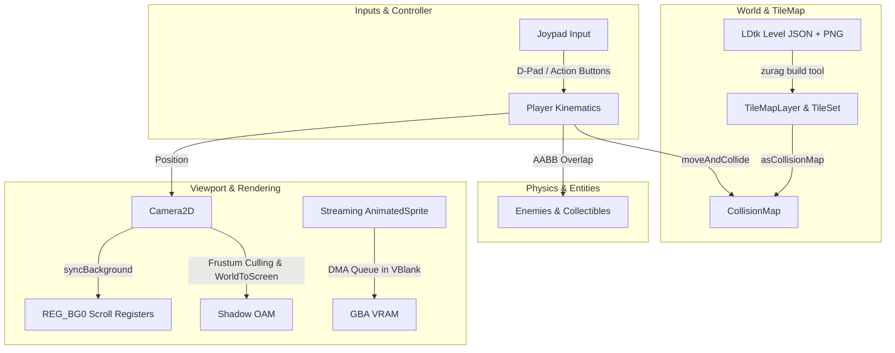

# Zamgba Demo Programs & Durable Showcase Plan

This document details all demo ROMs currently implemented in Zamgba, explains their technical capabilities, and presents the architectural plan for our **Durable Showcase Game Demo** ("ARPG Lite" / *Tsetseg's Quest*).

---

## 1. Overview of Demo Architecture

Zamgba organizes demonstration ROMs into two complementary categories:

1. **Focused Technical Demos (`demo/hal/` & `demo/engine/`)**:
   Isolated, single-feature testbeds created during Test-Driven Development (TDD). These verify specific hardware registers, low-level algorithms, or engine subsystems in isolation.
2. **Durable Showcase Demo (`demo/game/`)**:
   A cohesive, continuously evolving micro-game designed to demonstrate the complete, end-to-end integration of Zamgba's engine capabilities across releases. Developers can follow this single project to understand real-world best practices.

---

## 2. Complete Demo Catalog & Release Milestones

### 2.1 Hardware Abstraction Layer (HAL) Demos

| Status | ROM Name | Source Path | Milestone | Key Capabilities Demonstrated |
| :---: | :--- | :--- | :---: | :--- |
| `[x]` | `mode3_lines` | `demo/hal/mode3_lines.zig` | `v0.1.0` | Mode 3 true-color bitmap rendering ($240 \times 160$, 16-bit BGR555); Bresenham line algorithm (`gfx2d.drawLine`) writing directly to VRAM. |
| `[x]` | `sprite_hal` | `demo/hal/sprite_hal.zig` | `v0.1.0` | Direct GBA OAM Object Attribute staging (`ObjAttr`); hardware palette setup in OBJ PALRAM; smooth sprite bounce in a VBlank loop. |
| `[x]` | `joypad_hal` | `demo/hal/joypad_hal.zig` | `v0.1.0` | Direct polling of `REG_KEYINPUT`; edge detection and bitwise button masking. |
| `[x]` | `background_hal` | `demo/hal/background_hal.zig` | `v0.3.0` | Direct Mode 0 register configuration (`REG_DISPCNT`, `REG_BG0CNT`); manual PALRAM and Charblock/Screenblock loading; real-time interactive scrolling via `REG_BG0HOFS`/`REG_BG0VOFS` on D-Pad input. |
| `[x]` | `panic_demo` | `demo/hal/panic_demo.zig` | `v0.3.0` | Bare-metal panic handler (`@panic`); CPU register capture, interrupt disablement, diagnostic dispatch to mGBA debug registers, and visual red-backdrop warning. |
| `[x]` | `mgba_init` | `demo/hal/mgba_init.zig` | `v0.3.0` | Handshake negotiation and zero-cost formatted logging via mGBA debug register I/O (`0x04FF2000`). |
| `[ ]` | `mode4_pageflip` | `demo/hal/mode4_pageflip.zig` | `v0.3.0` | Mode 4 double-buffered 8-bpp bitmap rendering ($240 \times 160$) with page flipping (`hal.display.flipPage()`) for tear-free animations. |

### 2.2 High-Level Engine Demos

| Status | ROM Name | Source Path | Milestone | Key Capabilities Demonstrated |
| :---: | :--- | :--- | :---: | :--- |
| `[x]` | `sprite_engine` | `demo/engine/sprite_engine.zig` | `v0.1.0` | High-level **Static Namespace** game loop (`engine.run(@This())`); automatic dynamic OAM staging, VBlank management, and bounds bouncing. |
| `[x]` | `sprite_instanced` | `demo/engine/sprite_instanced.zig` | `v0.1.0` | High-level **Pointer-to-Instance** game loop (`engine.run(&game)`); recommended pattern for modular games requiring state serialization. |
| `[x]` | `joypad_instanced` | `demo/engine/joypad_instanced.zig` | `v0.1.0` | High-level gamepad input (`engine.input.InputState`); dynamic sprite palette bank swapping on boundary collision. |
| `[x]` | `collision_demo` | `demo/engine/collision_demo.zig` | `v0.1.0` | 2D AABB collision detection, bitmask collision filtering (`Collision.layer`, `Collision.mask`), patrol AI, and collision-triggered state resets. |
| `[x]` | `pong` | `demo/engine/pong.zig` | `v0.1.0` | Complete, playable classic Pong game; paddle velocity kinematics, AI tracking, wall reflections, score tracking, and ball-paddle collision response. |
| `[~]` | `flappy_tsetseg` | `demo/engine/flappy_tsetseg.zig` | `v0.2.0` | Multi-frame animated sprite playback using manual VRAM copying and tile index calculation *(deprecated in v0.3.0; anti-pattern superseded by `AnimatedSprite`)*. |
| `[~]` | `flappy_tsetseg_streaming`| `demo/engine/flappy_tsetseg_streaming.zig`| `v0.2.0` | Dynamic VRAM Streaming sprite animation via buddy allocator and DMA queue *(deprecated in v0.3.0; superseded by `sprite_animation_streaming`)*. |
| `[x]` | `sprite_static_fill` | `demo/engine/sprite_static_fill.zig` | `v0.3.0` | Procedural and solid-color sprite generation using `StaticSprite.fillSolidColor()`. |
| `[ ]` | `sprite_animation_static` | `demo/engine/sprite_animation_static.zig` | `v0.3.0` | High-level multi-frame sprite playback using `AnimatedSprite` in `.static` mode (all frames resident in VRAM, zero DMA overhead during playback). |
| `[ ]` | `sprite_animation_streaming` | `demo/engine/sprite_animation_streaming.zig` | `v0.3.0` | High-performance VRAM streaming sprite playback using `AnimatedSprite` in `.streaming` mode (`VramAllocator` dynamic slot + `DmaQueue` VBlank transfers). |
| `[ ]` | `camera_demo` | `demo/engine/camera_demo.zig` | `v0.3.0` | Interactive `Camera2D` showroom; demonstrates target tracking, deadzone (`DragMargin`), bounds clamping (`CameraLimits`), screen shake (`shake`), and frustum culling. |
| `[ ]` | `parallax_scroll` | `demo/engine/parallax_scroll.zig` | `v0.3.0` | Multi-layer Mode 0 background parallax scrolling (`applyToTileMapWithParallax`) across foreground, midground, and distant background layers. |
| `[ ]` | `tilemap_collision` | `demo/engine/tilemap_collision.zig` | `v0.3.0` | Continuous sub-pixel physics (`Fixed24_8`) colliding against `TileMapLayer.asCollisionMap()`, demonstrating smooth wall sliding and obstacle resolution. |
| `[ ]` | `ldtk_minimal` | `demo/engine/ldtk_minimal.zig` | `v0.3.0` | Minimal (< 80 lines) pipeline verification loading `zurag`-generated LDtk level data and panning the viewport. |
| `[ ]` | `hud_tilemap` | `demo/engine/hud_tilemap.zig` | `v0.4.0` | Static status bar on BG0 overlaying scrolling game world, demonstrating GBA layer priority composition (`priority: u2`). |
| `[ ]` | `hud_sprite` | `demo/engine/hud_sprite.zig` | `v0.4.0` | Screen-space Sprite UI (hearts, item counters) rendered via `engine.drawSpriteUi` ignoring world camera translation. |

### 2.3 Durable Showcase Demo (Full Game Architecture)

| Status | ROM Name | Source Path | Milestone | Key Capabilities Demonstrated |
| :---: | :--- | :--- | :---: | :--- |
| `[ ]` | `tsetseg_quest` | `demo/game/tsetseg_quest.zig` | `v0.3.0`+ | Flagship ARPG Lite game demo unifying TileMap, LDtk, Camera2D, Streaming Animation, AABB Collision, and evolving across future milestones. |

*Legend: `[x]` Implemented and verified; `[ ]` Planned for release; `[~]` Deprecated (scheduled for removal).*

### 2.4 Transition Plan: Retiring Flappy Demos & Anti-Pattern Evaluation

The two initial sprite animation demos (`flappy_tsetseg` and `flappy_tsetseg_streaming`) are scheduled for retirement in v0.3.0 due to the following rationale:
1. **Misleading Name**: They are not genuine Flappy Bird gameplay (no gravity curve or pipe-dodging mechanics), which causes user confusion.
2. **Conflated Concerns**: They mixed sprite animation, ad-hoc red-pillar collision, and arbitrary patrol movement in a single file, obscuring the core animation APIs.

#### Evaluation of "Animation via Manual StaticSprite" (`sprite_animation_via_static`)
In `flappy_tsetseg.zig`, multi-frame playback was achieved by manually copying raw tile words to VRAM pointers (`hal.MemorySections.VRAM + 32768`) and incrementing `player.tile_index = anim_frame * TILES_PER_FRAME_8BPP` on a `StaticSprite`.

**Decision: Reject as a dedicated demo.**
- **Anti-Pattern Risk**: Promoting this approach in an official demo legitimizes a hacky workaround that completely bypasses Zamgba's type-safe `AnimatedSprite` subsystem.
- **Error-Prone**: It requires developers to manually handle raw pointer casts, tile index math, frame duration ticks, and animation reset logic.
- **First-Class Alternative Available**: `AnimatedSprite.init(&sheet, .static, ...)` already provides idiomatic, safe all-frame resident animation without any of the manual pointer arithmetic.

#### The Triad of Focused Sprite Demos
Instead of conflated demos or anti-pattern workarounds, Zamgba provides three clean, focused (< 100 lines) sprite demos:
1. **`sprite_static_fill.zig`**: Demonstrates procedural tile generation and solid-color sprites using `StaticSprite.fillSolidColor()`.
2. **`sprite_animation_static.zig`**: Demonstrates idiomatic preloaded animation where all frames reside in VRAM via `AnimatedSprite` in `.static` mode.
3. **`sprite_animation_streaming.zig`**: Demonstrates dynamic DMA streaming animation where only 1 frame slot is reserved in VRAM via `AnimatedSprite` in `.streaming` mode.

The combined gameplay mechanics (4-direction kinematics, continuous wall collision, camera tracking) are absorbed cleanly by the flagship showcase demo `tsetseg_quest` (`demo/game/tsetseg_quest.zig`).

---

## 3. The Durable Showcase Demo: ARPG Lite (*Tsetseg's Quest*)

### 3.1 Motivation & Vision

While standalone technical demos prove that individual components compile and run, real game development requires coordinating multiple engine subsystems concurrently:
- Camera tracking must sync with TileMap background scroll registers.
- Physics collision must query TileMap collision masks via `moveAndCollide`.
- Large animated characters must stream into VRAM without exceeding VBlank DMA transfer limits.
- Screen-space UI must remain fixed while the world camera moves.

The **Durable Showcase Demo** serves as the canonical reference implementation that grows with every SDK milestone. Developers can follow the evolution of this single project to learn new features in context.

### 3.2 Design Constraints

1. **Zero Copyright / IP Infringement**:
   - Game mechanics and dungeon layouts are original or generic public-domain top-down adventure tropes.
   - All visual assets are custom-authored original artwork (featuring the author's original character *Tsetseg*).
2. **Comprehensive v0.3.0 Feature Coverage**:
   - Background TileMap with LDtk level data imported via `zurag`.
   - `Camera2D` viewport tracking, drag margins, bounds clamping, frustum culling, and screen shake.
   - Streaming animated sprites using the buddy allocator and DMA queue.
   - 4-direction continuous kinematics using `Fixed24_8` with AABB collision and sliding response (`moveAndCollide`).
   - Diagnostic logging to mGBA.
3. **Strict Code Budget (< 1,000 Lines)**:
   - The entire implementation remains concise, readable, and free of over-engineered boilerplate so that a developer can digest it in a single reading session.

---

## 4. Feature Showcase Breakdown (v0.3.0 Baseline)



### 4.1 Mode 0 Background & LDtk Tilemap Pipeline
- **Asset Generation**: An author designs a $64 \times 64$ tile ($512 \times 512$ pixel) dungeon in LDtk, defining visual tiles and an `IntGrid` collision layer (walls, pits, doors).
- **Compile-Time Pipeline**: The `zurag` tool extracts unique 8x8 tiles, generates packed 16-bit `ScreenEntry` arrays, and generates a Zig module with `TileSet`, `MapLayerData`, and collision bitmasks.
- **Runtime Binding**: `TileMapLayer` registers to hardware background 0 (Charblock 0, Screenblock 16) and synchronizes scroll registers every frame.

### 4.2 Camera2D Viewport Tracking & Screen Shake
- **Target Tracking**: The camera tracks Tsetseg using smooth lerp interpolation (`smooth_speed`).
- **Drag Margin**: A configurable dead-zone window prevents micro-jitter when making subtle adjustments.
- **World Clamping**: `CameraLimits` keeps the camera within $(0, 0)$ and $(512 - 240, 512 - 160)$, preventing rendering outside the dungeon bounds.
- **Frustum Culling**: Off-screen dungeon props and enemies are culled before writing to shadow OAM.
- **Screen Shake**: Taking damage or triggering traps sets `shake_intensity`, producing decaying screen shake offsets.

### 4.3 Streaming Animated Sprite
- **Player Animation**: Tsetseg features multi-frame 4-directional walking and idle animations.
- **Memory Efficiency**: Instead of pre-allocating all directional frames in VRAM, `AnimatedSprite` allocates only active slots through `vram_allocator` and streams upcoming frames through `dma_queue` during VBlank.

### 4.4 Continuous Physics & Collision
- **Sub-pixel Precision**: Movement vectors use signed `Fixed24_8` fixed-point arithmetic.
- **Wall Sliding**: Collision resolution against the dungeon's `CollisionMap` uses `moveAndCollide`, allowing smooth sliding along walls rather than abrupt sticking.
- **Entity Interaction**: AABB layer and mask filters distinguish between hostile entities (monsters, spikes) and interactive items (chests, keys, switches).

---

## 5. Architectural Code Budget (< 1,000 Lines)

The showcase is organized cleanly into four core modules within a single file or lightweight directory:

| Component | Target Line Count | Responsibilities |
| :--- | :--- | :--- |
| **`GameState` & Setup** | ~100 lines | ROM header registration, hardware initialization, memory allocation, level state reset. |
| **`Player` Entity** | ~180 lines | Input processing, 4-way direction animation selection, velocity calculation, `moveAndCollide` execution. |
| **`World` & Actors** | ~220 lines | LDtk TileMap binding, enemy AI (simple patrol/chase), collectible items (keys, chests), trigger doors. |
| **`Render` & Game Loop** | ~150 lines | Camera update, screen shake processing, sprite staging, VBlank frame flush, mGBA status logging. |
| **Total** | **~650 lines** | Well below the 1,000-line constraint, ensuring maximum pedagogical clarity. |

---

## 6. Long-Term Evolution Roadmap

The ARPG Lite demo will systematically adopt new engine features as milestones are released:

```
v0.3.0: Core Exploration & Kinematics
   └── TileMap, LDtk, Camera2D, Streaming Animation, AABB Collision
v0.4.0: UI, HUD & Typography
   └── Hearts/Key Counter (Screen-Space Sprites), 8x8 Dialogue Text Box
v0.5.0: Save System & State Persistence
   └── Cartridge SRAM/Flash Serialization (Chests, Keys, Unlocked Doors)
v0.6.0 ~ v0.7.0: Audio Subsystem & Juice
   └── PSG Chiptune Dungeon BGM, Sound FX (Hit, Slash, Door Open, Chest)
v0.8.0+: Polish & Advanced Visuals
   └── Affine Sprite Scaling/Rotation (Boss entrance, magic vortex)
```

### 6.1 Level Switching & Room Transitions
- **Dual-Door Navigation**: Stepping onto an exit tile triggers a level transition. The demo unloads the current actor list, resets the camera limits to the new room, loads the new LDtk tilemap, and repositions the player at the corresponding entrance door.
- **Persistent Flags**: Rooms remember opened chests and defeated unique encounters across transitions.

### 6.2 Bitmap Background Integration
- **Title Screen & World Map (Mode 4)**: Before entering the dungeon, the game displays a high-resolution 256-color Mode 4 title screen or island map with page flipping (`hal.display.flipPage()`).
- **Mode 0 Atmospheric Backdrops**: In open-air rooms, BG3 is configured with a 4-bpp starry sky or mountain vista that scrolls with parallax relative to the foreground dungeon tilemap.

### 6.3 Audio-Action Synchronization ("Game Feel")
When audio support arrives in v0.6.0 and v0.7.0, the demo will demonstrate high-impact audio-visual action synchronization:
1. **Attack Swing**: Triggers a whoosh sound effect on PSG Channel 4 (noise channel).
2. **Hit Impact**:
   - **Hitstop**: Freezes animations for 2 frames to convey tactile weight.
   - **Knockback**: Applies a rapid impulse vector away from the attack source.
   - **Screen Shake**: Induces camera shake via `camera.shake_intensity`.
   - **Audio Punch**: Plays an impact sound effect.
   - **Visual Invulnerability**: Flashes the sprite through OAM visibility toggles.
3. **Puzzle Solve / Chest Open**: Plays a classic rising arpeggio sound effect upon collecting a key or opening a chest.
